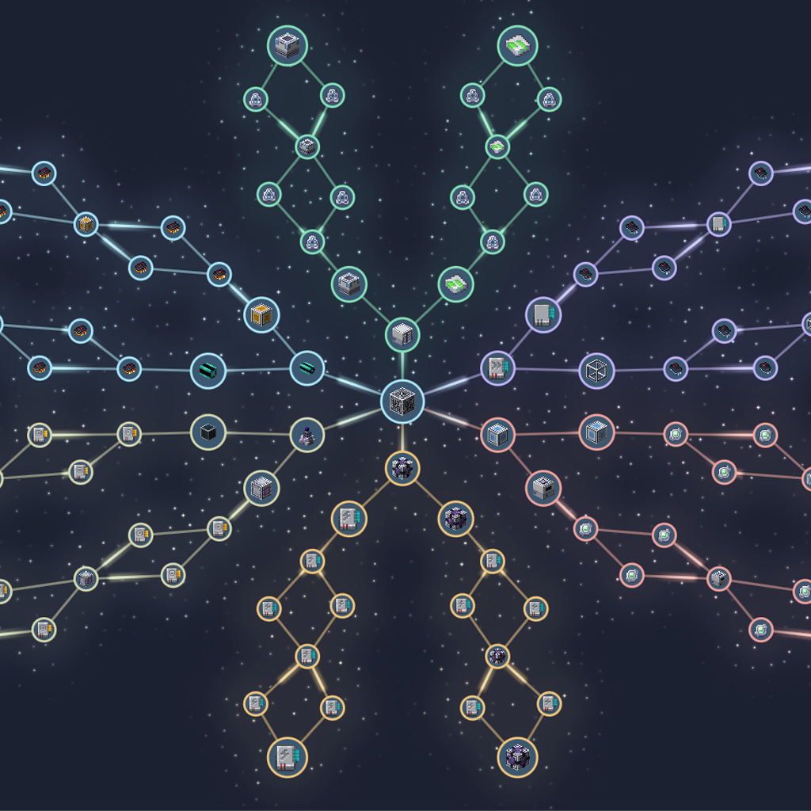

<p align="center">
  
</p>

<h1 align="center">AEUpgradeTree</h1>

<p align="center">
  An Applied Energistics 2 addon featuring a research tree. Each ME network with a controller has its own progress and
upgrades.<br>
</p>


## Features

- 420 nodes with branching paths and mutually exclusive branches.
- Upgrades change cable channel capacity, device channel and energy usage, and the speed and batch size of molecular
  assemblers.
- Configure pattern provider throughput, the number of slots in pattern providers and ME interfaces, and device limits
  per network.
- 32 autocrafting and item submission tasks across four tiers. Rewards include research points and items delivered to
  ME storage. Tasks are disabled by default.

## Installation

Both builds target Minecraft 1.21.1 and Java 21. Install the matching AEUpgradeTree jar on the client and server.

- NeoForge 21.1.x requires Applied Energistics 2 19.2.20 or newer in the 19.x series and UniGUI 1.6.4 or newer on the client.
- Fabric Loader 0.19.5 or newer requires Fabric API 0.116.17 or newer, UniGUI 1.6.4 or newer, and AE2 Fabricated
  `19.2.18-alpha.1+fabric`. [AE2 Fabricated](https://github.com/Fatin-Ishraq/ae2-fabricated)

Jade is optional. [UniGUI releases](https://github.com/DeusSixik/UniGUI/releases)

## Getting started

1. Open a running ME controller and click **ME Upgrade** to the right of **Export Grid**. By default, the tree is
   available to the controller owner and operators.
2. Double-click an available node to research it using the network's points. By default, a new network starts with 4
   points.
3. To gain another point, use a research certificate on a running controller. If the server has enabled tasks, you can
   earn additional points in the **Tasks** tab.

## Server and modpack configuration

In the **ME Upgrade** window, operators can access the **Edit tree** button. The editor lets you change nodes, links,
and effects, as well as configure the starting point balance, refunds when resetting research, and certificate drops
when the last controller block is destroyed. The **Save tree** button writes the tree to
`config/aeupgrade/upgrade-tree.json`.

Tasks are configured in a separate section of the editor. The **Save tasks** button writes them to
`config/aeupgrade/research-tasks.json`.

## Building

The Gradle wrapper selects a JDK 25 daemon. Both Stonecutter variants compile the mod for Java 21.

```sh
./gradlew :1.21.1-neoforge:build
./gradlew :1.21.1-fabric:build
```

For Fabric, check out AE2 Fabricated at revision `50cd3c4ae7406ef12c39fa325218a33ff006b1c2` and run `./gradlew remapJar`
with JDK 25 in its `port/` directory. Copy `ae2-fabricated-19.2.18-alpha.1+fabric.jar` from `port/build/libs/` into this
project's `libs/` directory, or pass the absolute path with `-Pae2_fabric_jar=...`.

The mod jars are written to `versions/1.21.1-neoforge/build/libs/` and `versions/1.21.1-fabric/build/libs/`.

Licensed under the GNU LGPL 3.0.
